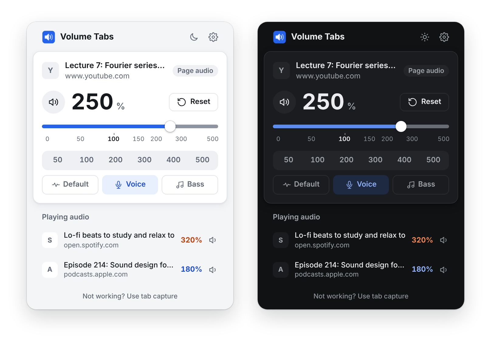
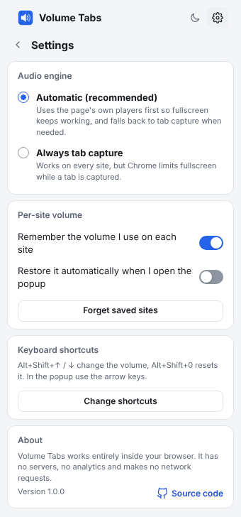

<p align="center">
  
</p>

<h1 align="center">Volume Tabs</h1>

<p align="center">
  Make any browser tab louder, up to 500%.<br>
  Open source, no tracking, no data collection.
</p>

<p align="center">
  <a href="https://github.com/cngil/volume-tabs/releases/latest"></a>
  <a href="https://github.com/cngil/volume-tabs/actions/workflows/ci.yml"></a>
  <a href="LICENSE"></a>
</p>

<p align="center">
  <a href="https://github.com/cngil/volume-tabs/releases/latest"><b>Download</b></a>
  &nbsp;·&nbsp;
  <a href="#install">Install</a>
  &nbsp;·&nbsp;
  <a href="#privacy">Privacy</a>
  &nbsp;·&nbsp;
  <a href="#how-it-works">How it works</a>
</p>

<p align="center">
  
</p>

## Features

- **0% to 500% volume per tab**, in 1% steps: slider, mouse wheel or trackpad (hold Shift for 1% steps), arrow keys, or type the number.
- **A slider that follows your ears:** above 100% every equal move sounds like the same step louder, it snaps to 100% as you pass it, and a double-click returns to 100%. Big jumps up fade in instead of blasting.
- **Sound modes:** *Default* leaves the sound untouched, *Voice* makes dialogue and podcasts clearer, *Bass* fills out music.
- **Playing tabs:** every tab that is playing audio, with its level. Click one to jump to it.
- **Per-site memory:** remembers the level you used on each site. *Restore* brings it back, *Reset* returns to 100%.
- **Keyboard shortcuts:** `Alt+Shift+Up` / `Alt+Shift+Down` change the volume by 10%, `Alt+Shift+0` resets it. In the popup: arrow keys, `M` to mute, `0` to reset.
- **Toolbar badge** with the current level of each tab.
- **Light and dark themes**, in English and Turkish.
- **Fullscreen keeps working in Chrome** in most cases. See [How it works](#how-it-works).

<details>
<summary><b>Settings</b></summary>
<br>
<p align="center">
  
</p>
</details>

## Browser support

| Browser | Install | Engines |
| --- | --- | --- |
| Chrome, Edge, Brave | Download the zip from [Releases](https://github.com/cngil/volume-tabs/releases/latest) | Page audio, with tab capture as fallback |
| Firefox 128+ | Download the zip from [Releases](https://github.com/cngil/volume-tabs/releases/latest) | Page audio |
| Safari 16.4+ | [Build and sign it yourself](#safari) | Page audio |

## Privacy

- **No data collection.** No analytics, telemetry, servers or ads, and the extension makes **no network requests**.
- **No remote code.** No `eval`, no CDN, no third-party libraries. There is no bundler or minifier, so the code you install is exactly the code in [`src/`](src).
- **Minimal access.** No permanent access to websites. A page is only touched when you open the popup on that tab (`activeTab`), and its content is never read.
- Saved site levels stay in your browser (`storage.local`) and can be cleared in Settings. Per-tab state is cleared when the browser closes.
- A strict Content Security Policy and no `web_accessible_resources`, so websites cannot detect or call the extension.

More in [PRIVACY.md](PRIVACY.md) and [SECURITY.md](SECURITY.md).

<details>
<summary><b>Why each permission is needed</b></summary>
<br>

| Permission | Why |
| --- | --- |
| `activeTab`, `scripting` | Process the audio of the tab you opened the popup on |
| `tabs` | Titles for the playing tabs list, and the site name for per-site memory |
| `storage` | Your settings and saved site levels, kept locally |
| `tabCapture`, `offscreen` *(Chrome)* | Fallback for sites where the page's own players cannot be used |
| `favicon` *(Chrome)* | Show tab icons from Chrome's local cache, without network requests |
| `<all_urls>` *(Firefox, optional, off by default)* | Only if you turn it on in Settings: re-apply the boost after reloads and work inside embedded players |

</details>

## Install

Store listings are not published yet. Download the package for your browser from the [latest release](https://github.com/cngil/volume-tabs/releases/latest).

**Chrome, Edge, Brave**
1. Unzip `volume-tabs-chrome-<version>.zip`.
2. Open `chrome://extensions` and turn on *Developer mode*.
3. Click *Load unpacked* and select the unzipped folder.

**Firefox**
1. Open `about:debugging#/runtime/this-firefox`.
2. Click *Load Temporary Add-on* and select `volume-tabs-firefox-<version>.zip`.

The Firefox package is not signed by Mozilla yet, so Firefox removes it on restart, and opening it directly shows "not verified". For a permanent install, upload it to [addons.mozilla.org](https://addons.mozilla.org/developers/) as an unlisted add-on; Mozilla signs it for free.

**From source:** you need [Node.js](https://nodejs.org) 20 or newer and nothing else.

```bash
git clone https://github.com/cngil/volume-tabs.git
```

```bash
cd volume-tabs && npm run build
```

This writes unpacked extensions to `dist/chrome`, `dist/firefox` and `dist/safari`. `npm run package` also writes zip files.

### Safari

Safari extensions ship inside a macOS app, and this project does not publish a signed one, so you build and sign it yourself. You need a Mac with Xcode and Safari 16.4 or newer.

1. Build the extension:

   ```bash
   npm run build
   ```

2. Wrap `dist/safari` in an Xcode project, using your own reverse-domain bundle identifier:

   ```bash
   xcrun safari-web-extension-converter dist/safari --project-location build/safari --app-name "Volume Tabs" --bundle-identifier com.example.volumetabs --macos-only --copy-resources --no-open
   ```

3. Open `build/safari/Volume Tabs/Volume Tabs.xcodeproj` in Xcode. For both the app target and the extension target, open *Signing & Capabilities* and pick your team (a free Personal Team works for your own Mac). Then choose *Product > Run*.
4. In Safari, open *Settings > Advanced* and turn on *Show features for web developers*. If Volume Tabs is missing from *Settings > Extensions*, choose *Develop > Allow Unsigned Extensions*. Safari turns this off again when it quits.
5. Enable Volume Tabs in *Settings > Extensions*, and allow it on the sites you want to control when Safari asks.

Safari support is new and has not been tested on a Mac yet. If something does not work, please [open an issue](https://github.com/cngil/volume-tabs/issues). Sharing the app with other people requires an Apple Developer Program membership.

## How it works

Audio is processed with the browser's built-in [Web Audio API](https://developer.mozilla.org/docs/Web/API/Web_Audio_API):

```text
tab audio -> gain (0-500%) -> bass shelf -> voice filters -> ceiling -> speakers
```

The filters stay flat in Default mode. The ceiling only works above 100%, and only on peaks that would otherwise clip, so boosted audio does not distort; at 100% or below the sound is untouched. There are two ways to get at the audio:

1. **Page audio** (all browsers): the page's own `<audio>` and `<video>` elements are routed through the chain, so fullscreen and everything else keep working. DRM-protected media and cross-origin media without CORS would turn silent if routed, so those are left untouched.
2. **Tab capture** (Chrome only): `chrome.tabCapture` captures the whole tab's audio and processes it in a hidden offscreen document. It works on every site, but Chrome keeps fullscreen video inside the window while a tab is captured. Capture stops on its own a few seconds after the level returns to 100%.

In Chrome's *Automatic* mode, page audio is tried first and tab capture is the fallback. You can force tab capture in Settings, or switch for a single tab from the line at the bottom of the popup.

Firefox and Safari have no tab capture API, so they use page audio only. DRM content (for example Netflix or Spotify) and cross-origin media without CORS cannot be boosted there. This applies to every extension of this kind on those browsers.

## Development

```text
src/
  background/   core.js (shared logic), chrome-backend.js, page-backend.js, page-host.js
  content/      page-engine.js, injected on demand into the controlled tab
  offscreen/    Chrome tab capture audio processing
  popup/        user interface
  shared/       audio chain, settings, storage
manifests/      base.json plus Chrome, Firefox and Safari additions
scripts/        build.mjs (dependency-free build and zip)
```

```bash
npm test
```

```bash
npm run lint:firefox
```

Releases are published by the [Release workflow](.github/workflows/release.yml): bump the version in `package.json`, add `docs/releases/v<version>.md`, then run the workflow from the Actions tab.

The popup design follows [Impeccable](https://github.com/pbakaus/impeccable): product context lives in [PRODUCT.md](PRODUCT.md) and the visual system in [DESIGN.md](DESIGN.md).

Contributions are welcome. Please keep the project free of dependencies, remote resources and network requests.

## License

[MIT](LICENSE)
